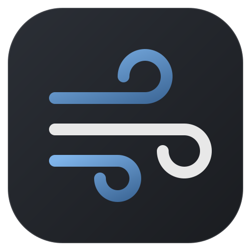
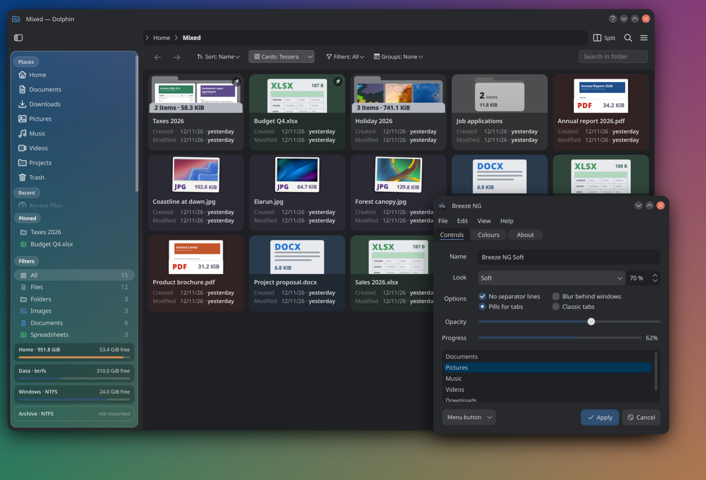
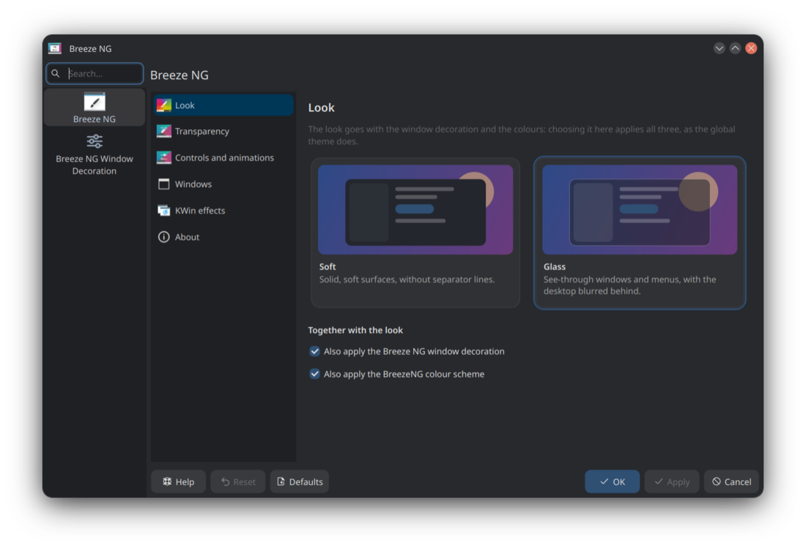
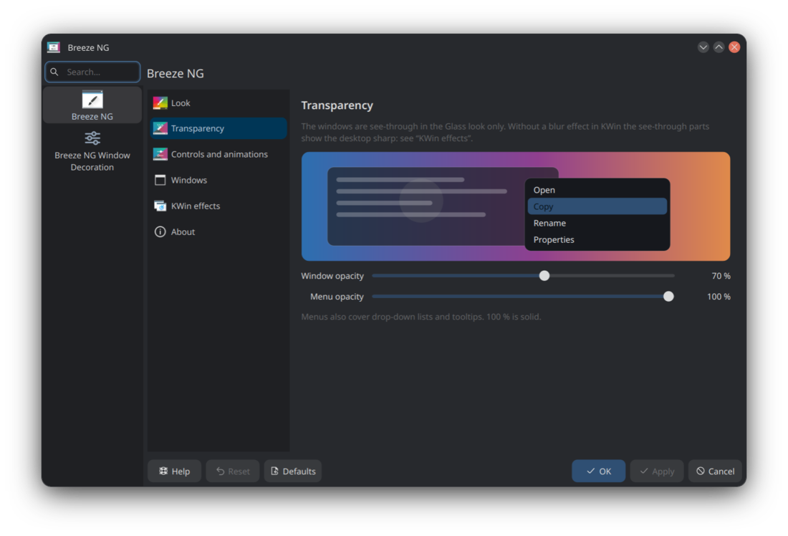
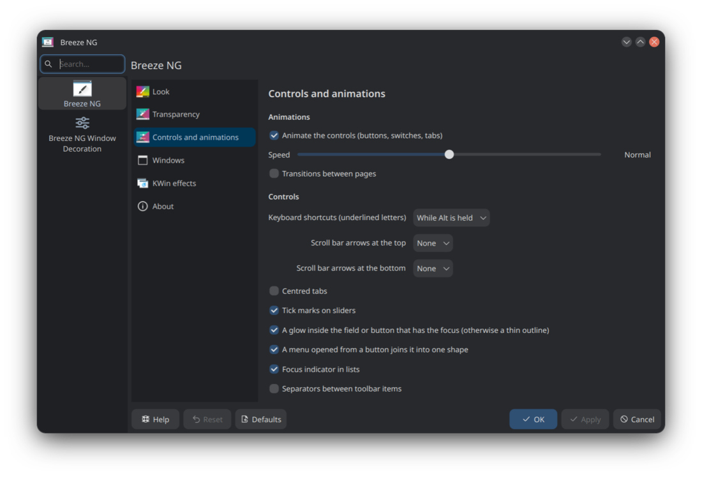
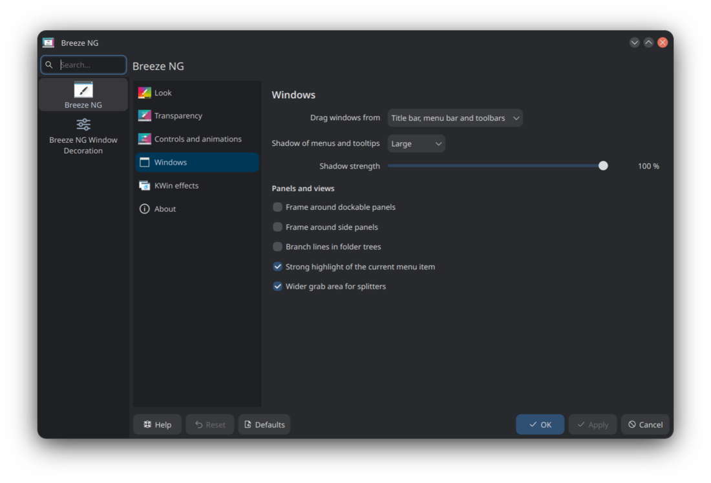
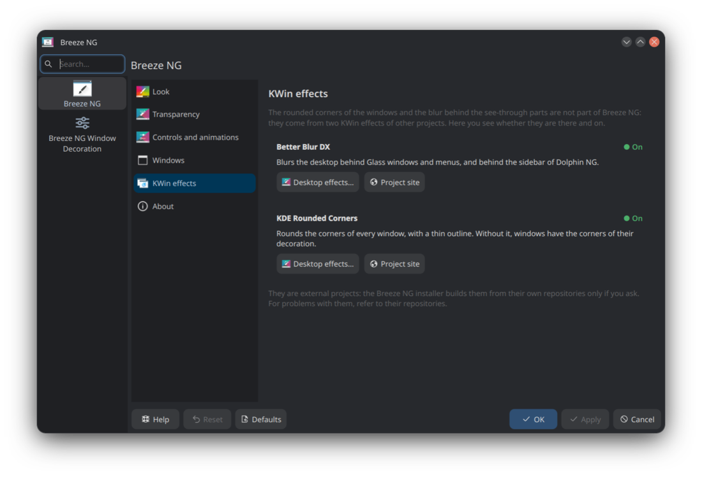
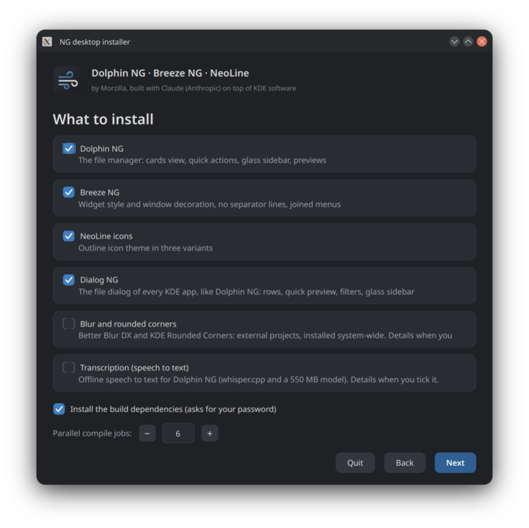
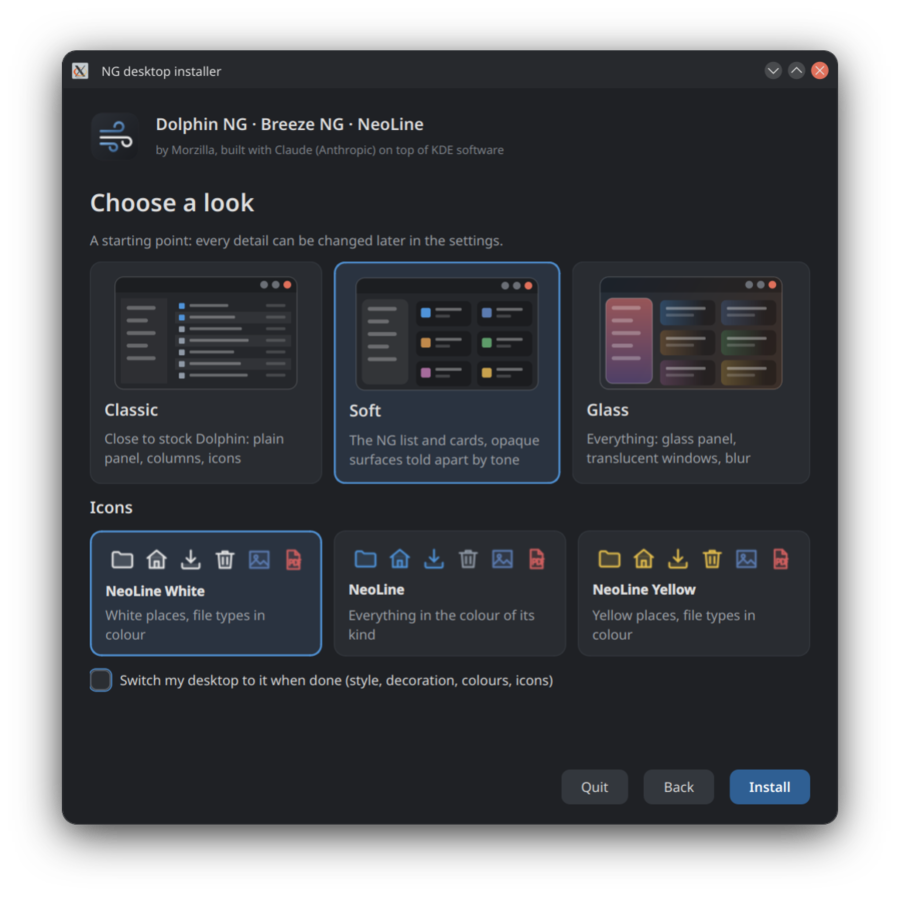

# Breeze NG



A fork of KDE's [Breeze](https://invent.kde.org/plasma/breeze) widget style and window decoration with two looks
that go further than the original: **Soft** and **Glass**. It installs next to the stock Breeze, under its own
names, and leaves it untouched.

**Try it with the graphical installer: [what it does, step by step](#everything-at-once).** Pick the parts of the NG
desktop (Breeze NG, [Dolphin NG](https://github.com/Morzilla/dolphin-ng), the NeoLine icons, Dialog NG), pick a look,
and watch it build. Everything goes into your home folder, next to the stock applications, and nothing is replaced:

```sh
bash <(curl -fsSL https://raw.githubusercontent.com/Morzilla/breeze-ng/ng/ng/install-gui.sh)
```

| | Soft | Glass |
|---|---|---|
| surfaces | told apart by tone, no outlines at rest | translucent sheets the compositor blurs behind |
| controls | 9 px radii, a tone that fades in on hover and press | the same, with a faint edge and a lit top hairline |
| selection | the accent colour in content views, a tone in side panels | a pale sheet of light |
| windows | opaque, 14 px corners, title on the left, disc buttons | 70 % opaque with blur, same frame |

Both looks share: no separator lines anywhere, menus with padded rounded panels and a solid accent block on the
current item, tabs that are one sheet with their panel, a neon glow inside fields and buttons that have the focus,
and a menu opened from a button that joins it into one shape.




## Part of the NG desktop

- [Dolphin NG](https://github.com/Morzilla/dolphin-ng) – the file manager with cards and drawn rows, groups and filters one click away, quick actions and work in progress shown on the files ([KDE Store](https://store.kde.org/p/2381561/))
- [NeoLine](https://github.com/Morzilla/neoline-icons) – the outline icon theme in the screenshots ([KDE Store](https://store.kde.org/p/2381562/))
- [Dialog NG](https://github.com/Morzilla/dialog-ng) – the Open/Save window of every KDE app in Dolphin NG's look: drawn rows, a quick preview on hover, filters with their counts, the glass sidebar
- Breeze NG on the KDE Store: https://store.kde.org/p/2381557/

## Parts

- `kstyle/` – the widget style, plugin key `BreezeNG`
- `kdecoration/` – the KWin decoration `org.kde.breezeng`, themes `Breeze NG Soft` and `Breeze NG Glass`
- [`ng/breeze-ng`](ng/breeze-ng) – build, install and switch script
- [`ng/look-and-feel/`](ng/look-and-feel/) – the two global themes (System Settings › Global Theme)
- [`ng/color-schemes/BreezeNG.colors`](ng/color-schemes/BreezeNG.colors) – the colour scheme both looks were designed on
- [`ng/demo-controls.py`](ng/demo-controls.py) – a small window with the common controls, to see the style at a glance

The installers keep the sources in `~/.local/src/breeze-ng`, so the commands below use that path.

## Settings

System Settings › Appearance › Application Style › Breeze NG › Configure (or `~/.local/src/breeze-ng/ng/breeze-ng settings`) opens the
settings of the style, in pages:

- **Look** – Soft or Glass; choosing one also applies the Breeze NG window decoration and the BreezeNG colour
  scheme (each can be left out).
- **Transparency** – how see-through windows (Glass) and menus are, with a live preview.
- **Controls and animations** – animation speed, keyboard shortcut underlines, scroll bar arrows, centred tabs, the
  glow inside the focused field or button (off: a thin outline), menus joining the button they open from.
- **Windows** – where windows can be dragged from, the shadow of menus and tooltips, frames and tree lines.
- **KWin effects** – whether the two external effects the screenshots rely on (Better Blur DX for the blur, KDE
  Rounded Corners for the window corners) are installed and on, with links to them.

Everything is stored in `breezengrc`. The variant follows the decoration theme chosen in KWin (`Breeze NG Soft` or
`Breeze NG Glass`), which is what the global themes and the Look page set; `[Common] Variant=Soft|Glass` is the
fallback.



| Transparency | Controls and animations |
|---|---|
|  |  |
| **Windows** | **KWin effects** |
|  |  |

## Everything at once

[`ng/install-desktop.sh`](ng/install-desktop.sh) installs the whole desktop this style belongs to: [Dolphin NG](https://github.com/Morzilla/dolphin-ng),
Breeze NG, the [NeoLine icons](https://github.com/Morzilla/neoline-icons) and the [NG file dialog](https://github.com/Morzilla/dialog-ng), dependencies included. It asks what to
install and whether to switch the desktop to it; `--yes` runs it without questions, `--help` lists the options,
`--licence` prints the notices (the installer is MIT; Breeze NG and Dolphin NG stay GPL).

```
bash <(curl -fsSL https://raw.githubusercontent.com/Morzilla/breeze-ng/ng/ng/install-gui.sh)      # graphical
bash <(curl -fsSL https://raw.githubusercontent.com/Morzilla/breeze-ng/ng/ng/install-desktop.sh)  # in the terminal
```

The graphical installer is a small wizard: pick the parts, pick a look (Classic, Soft or Glass), watch it build. It
needs Python with PyQt6 or PySide6 and offers to install them; without them it falls back to the terminal one.

For every user of the computer instead of only yourself, there is a third script. It builds as you and copies into
the system with sudo: the style and Dolphin NG under `/opt/ng`, icons, colour scheme and global themes under
`/usr/local/share`, and one file in `/etc/xdg/plasma-workspace/env` that tells every Plasma session where the style
is. Nothing of the distribution is overwritten, and `--uninstall` removes it all.

```sh
bash <(curl -fsSL https://raw.githubusercontent.com/Morzilla/breeze-ng/ng/ng/install-system.sh)
```

Both can also install the two KWin effects the screenshots rely on, [Better Blur DX](https://github.com/xarblu/kwin-effects-better-blur-dx)
and [KDE Rounded Corners](https://github.com/matinlotfali/KDE-Rounded-Corners). That part is off unless you tick it:
they are external projects, not part of this one. The installer only builds them from their own repositories, the way
their READMEs describe, and installs them system-wide (the one step outside your home folder). For anything about
them, refer to their repositories.

| What to install | Choose a look |
|---|---|
|  |  |

`python3 ~/.local/src/breeze-ng/ng/demo-controls.py` opens the small window of the first screenshot, with the common controls, to see the style at a
glance.

## Build and install

Build dependencies are those of Breeze itself (`sudo dnf builddep breeze`, `sudo apt build-dep breeze`,
`sudo pacman -S --needed base-devel extra-cmake-modules kdecoration kwindowsystem …`). Then, with the sources where
the installers keep them:

```
git clone --branch ng https://github.com/Morzilla/breeze-ng.git ~/.local/src/breeze-ng
~/.local/src/breeze-ng/ng/breeze-ng build        # cmake + install into ~/.local/breeze-ng, plus the global themes
~/.local/src/breeze-ng/ng/breeze-ng env          # QT_PLUGIN_PATH for the session: log out and in once
~/.local/src/breeze-ng/ng/breeze-ng use glass    # or: use soft — style, decoration and colours, applied at once
~/.local/src/breeze-ng/ng/breeze-ng off          # back to Breeze
```

`~/.local/src/breeze-ng/ng/breeze-ng now` applies the plugin path to the running session without logging out (X11: it restarts KWin
and Plasma). Applications already open keep their style until restarted. Choosing a global theme from System
Settings also works: pick *Breeze NG Soft* or *Breeze NG Glass*.

## Limits

Only Qt Widgets applications take the full look (Dolphin, Kate, Konsole, Okular, Gwenview…). QML applications
such as System Settings or Discover draw their pages with Plasma's own QML theme and take only the controls from
a widget style. Applications that bundle their own Qt (Telegram) or are not Qt at all cannot use it.

`BREEZE_NG_DEBUG=1` prints a trace of the button-to-menu joining logic.

## What the installers change on your system

- **Build dependencies** are installed with your distribution's package manager. That step asks for root (sudo, or
  pkexec in the graphical installer) and is the only one that runs as root.
- **Sources** go into `~/.local/src`, and **everything is installed into `~/.local`**, next to the stock Breeze and
  Dolphin, which stay as they are. Nothing of your distribution is overwritten.
- **Applying a look** (only if you choose it) changes the widget style, window decoration, colours and icons of your
  session; `~/.local/src/breeze-ng/ng/breeze-ng off` goes back to Breeze.
- **The two optional KWin effects** (off unless you tick them) are the one exception: they are built from their own
  repositories and installed system-wide, under `/usr`.
- [`install-system.sh`](ng/install-system.sh) (for every user of the computer) is the other exception, by design: it copies into `/opt/ng`,
  `/usr/local/share` and one file in `/etc/xdg`, and `--uninstall` removes them.

## Licence

Breeze NG is an independent fork of KDE's [Breeze](https://invent.kde.org/plasma/breeze) and keeps its licences.
Every file states its own in an SPDX header, and the full texts are in [`LICENSES/`](LICENSES/):

| What | Licence |
|---|---|
| The widget style and the window decoration (`kstyle/`, `kdecoration/`), as in Breeze | mostly GPL-2.0-or-later; a few files GPL-2.0-only OR GPL-3.0-only OR a later version accepted by KDE e.V., or MIT, as they came from Breeze |
| The Soft and Glass work, by Morzilla | the licence of the file it is in; new files GPL-2.0-or-later |
| [`ng/breeze-ng`](ng/breeze-ng), the global themes and the colour scheme | GPL-2.0-or-later |
| The installers ([`ng/install-gui.sh`](ng/install-gui.sh), [`install-gui.py`](ng/install-gui.py), [`install-desktop.sh`](ng/install-desktop.sh), [`install-system.sh`](ng/install-system.sh)) | MIT |

The installers build other projects, each under its own licence: Dolphin NG (GPL-2.0-or-later, a fork of Dolphin),
the NeoLine icons (MIT), Dialog NG (LGPL-2.0-or-later, a patch on KDE's KIO), and, only if you choose them, Better Blur DX and KDE
Rounded Corners (both GPL-3.0, external projects not written or maintained here). `bash ~/.local/src/breeze-ng/ng/install-desktop.sh --licence`
prints all the notices.

Breeze NG, Dolphin NG and Dialog NG are not affiliated with or endorsed by KDE e.V.; "KDE", "Plasma", "Dolphin" and
"Breeze" are names and trademarks of their respective owners. The software comes with no warranty of any kind, as
the GPL and MIT licences say.

The mockups the Soft and Glass work follows are in the repository history of the sibling project
[dolphin-ng](https://github.com/Morzilla/dolphin-ng).
